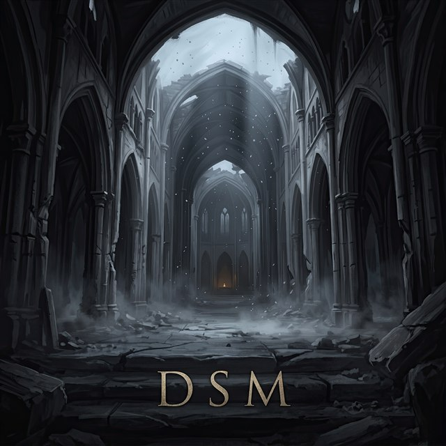

<div align="center">



# DSM — Dark Souls Mod Manager

**Dark Souls Remastered** · **Dark Souls III** · **Elden Ring**


</div>

---

Installing mods by hand usually goes like this: copy files into the game folder, forget which ones you replaced, then verify the game in Steam to undo it all. DSM does the copying for you and saves the original files before touching anything, so getting the clean game back is one button.

It's a single `DSM.exe`. It doesn't write anything to AppData or the registry; everything it creates stays in its own folder.

## ✦ What it does

When you start DSM, you pick a game: Dark Souls Remastered, Dark Souls III or Elden Ring (the Steam versions). Each game has its own list of mods and its own backups.

In the list, each mod has a bonfire next to it. Light it to turn the mod on, let it go out to turn it off, then press **Apply**. **Restore original** puts back every file DSM ever replaced.

Click a mod to see its description, the keys it uses in the game, and whether it gets along with your other mods. If two lit mods change the same file, both get a "conflict" mark, and the one lower in the list wins. To change the order, hover over a mod and use the arrows. If a mod's author says it doesn't work with another mod, you'll see "incompatible" instead.

**Refresh list** looks at the [mods in this repository](https://github.com/giahoki/DSManager/tree/main/mods) and downloads ones you don't have yet, plus newer versions of ones you do. It only downloads files that actually changed, so an update is usually quick. When a mod you've already installed gets updated, DSM tells you, and the main button turns into **Update**.

Mods can also come as patches instead of full game files. More on that [below](#patches-instead-of-game-files).

> [!WARNING]
> Dark Souls III and Elden Ring use EasyAntiCheat. **Play modded only offline.**
> Elden Ring only reads loose files through ModEngine 2, so support for it is still experimental.

## ✦ Getting started

1. Run the installer `DSM-Setup-<version>.exe`, or just put `DSM.exe` in any folder.
2. Start it and pick your game. DSM looks for it through Steam. If it can't find it, click the game card at the top and choose the folder with the game's exe (for example, `DarkSoulsRemastered.exe`).
3. Press **Refresh list** to get mods from GitHub, or put your own into `mods\<game name>\`.
4. Light the mods you want, press **Apply**, then **Play**.

The folder looks like this. You can move it anywhere, just move all of it together:

```
DSM\
├─ DSM.exe
├─ data\    which mods are on, what's installed, and the original game files
└─ mods\    your mods, one folder per game
```

> [!IMPORTANT]
> Close the game before applying or restoring mods.

## ✦ Making a mod

A mod is a folder. Whatever you put in its `files\` folder gets copied into the game folder at the same path:

```
mods\
└─ Dark Souls Remastered\
   └─ My Mod\
      ├─ mod.json
      └─ files\
```

So `files\param\DrawParam\a10_DrawParam.parambnd.dcx` replaces that same file in the game, and `files\dxgi.dll` goes right next to the game's exe.

`mod.json` is optional. Without it the mod shows up under its folder name. With it you get a proper name, author and description, and DSM can track versions:

```json
{
  "name": "My Mod",
  "version": "1.0",
  "author": "You",
  "description": "What the mod does.",
  "keys": [
    { "key": "F10", "action": "turn effects on or off" }
  ],
  "incompatible": ["Some Other Mod"]
}
```

When you release a new version, bump `version`. That's how DSM (and Refresh list) knows there's an update.

`keys` and `incompatible` are optional too. List your mod's hotkeys in `keys`, and DSM shows them next to the description. In `incompatible`, name the mods yours doesn't work with, by folder or by name. You don't need to list mods that change the same files: DSM finds those on its own.

### Patches instead of game files

If your mod changes a few values inside a game file, sharing the whole file means sharing FromSoftware's content along with it. A patch stores only your changes. When a player applies the mod, DSM takes the file from their own game and applies your changes to it.

Put patches in `patches\` instead of `files\`, at the same path plus `.dsmpatch`:

```
mods\<game>\<mod>\patches\param\DrawParam\a10_DrawParam.parambnd.dcx.dsmpatch
```

To make one, give DSM the original file and your edited version:

```bash
DSM.exe --make-patch <original> <modified> <file.dsmpatch>
```

DCX archives are compared unpacked, so even a patch for a big archive is usually tiny. If a player's file is a different version than the one you made the patch from, DSM tells them the patch doesn't fit and doesn't touch the game.

## ✦ Backups

The first time DSM replaces a game file, it saves the original to `data\<game id>\backup\`, for example `data\dsr\backup\`. Restoring just copies those files back.

A few things it's careful about:

- If the file in the game is already the modded version (say, you'd copied it by hand before), DSM won't save it as the "original".
- If Steam updates or repairs a file while a mod is on, DSM notices and won't overwrite the new file with the old backup.

Which mods are on and what's installed is stored in `data\<game id>\state.json`.

## ✦ Building from source

You'll need Visual Studio 2026. Open `DSM.slnx` and build `DSM` in Release or Debug (x64). For the installer you'll also need Inno Setup 6.

The interface is drawn by hand with GLFW and OpenGL 3.3: one SDF shader draws all the panels, frames and glow, and stb_truetype renders the fonts.

<details>
<summary><b>Where things end up after a build</b></summary>

<br>

The exe goes into `bin\`.

- On every build, the `mods\` folder from the project root is copied to `bin\mods`. Add new mods to the root `mods\`: the copy in `bin\` gets deleted when you clean the build.
- `data\` sits next to the exe, in `bin\data`.

> [!CAUTION]
> "Clean Solution" deletes all of `bin\` and `build\`, including `data\` with the backups of your game files. Press **Restore original** in DSM before cleaning.

</details>

<details>
<summary><b>Project notes</b></summary>

<br>

- To add a game, add one entry to `games()` in `src/game.cpp`.
- Fonts and logos are built into the exe (`src/DSM.rc`, with the source files in `assets/`). To add a game logo, put the image in `assets/icons`, add an `RCDATA` line for it to `DSM.rc`, and put that name in the game's `logo` field.
- The version number lives in `src/version.h`. The installer script (`DSM.iss`) reads it from the built exe and saves `DSM-Setup-<version>.exe` to `dist\`.
- The DS Upgrader Engine mod has its own project in `engine/`. See [`engine/NOTES.md`](engine/NOTES.md).

</details>

<details>
<summary><b>Command line for testing</b></summary>

<br>

Run DSM without a window. `--game` picks the game (`dsr`, `ds3` or `er`), and `sync` does the same thing as Refresh list:

```bash
DSM.exe --cli status|apply|restore|sync|enable <mod>|disable <mod> [--game dsr|ds3|er]
```

Open a game right away, skipping the selection screen:

```bash
DSM.exe --game ds3
```

Save a screenshot of the interface without opening a window:

```bash
DSM.exe --screenshot out.png --shot-time 3
```

</details>

## ✦ Thanks

DSM uses these projects:

- [GLFW](https://www.glfw.org/) (zlib/libpng)
- [stb_truetype, stb_image, stb_image_write](https://github.com/nothings/stb) (public domain / MIT)
- [nlohmann/json](https://github.com/nlohmann/json) (MIT)
- [miniz](https://github.com/richgel999/miniz) (MIT)
- Cormorant Garamond and Cormorant SC fonts (SIL Open Font License)

The DS Upgrader mod includes ReShade (BSD-3-Clause), plus SMAA and CAS from SweetFX, Glamarye Fast Effects, prod80 shaders and Deband (MIT).

The full license texts are in [`THIRD-PARTY-LICENSES.md`](THIRD-PARTY-LICENSES.md). If you share DS Upgrader on its own, without DSM, include that file with it.

## ✦ License

DSM's code is licensed under **[PolyForm Noncommercial 1.0.0](LICENSE.md)**.

| ✅ You may | ❌ You may not |
|---|---|
| use, study, modify, build on and share it for noncommercial purposes | sell DSM or works based on it, or use them commercially |

If you share DSM or something based on it, keep `LICENSE.md` and the `Required Notice` line with the author's name.

This license only covers DSM's own code and design. The projects listed above keep their own licenses. Game names and logos (like `assets/icons/DS R logo.png`) belong to FromSoftware and Bandai Namco and aren't covered by it.

<div align="center">
<br>

*Praise the sun.* ☀

</div>
